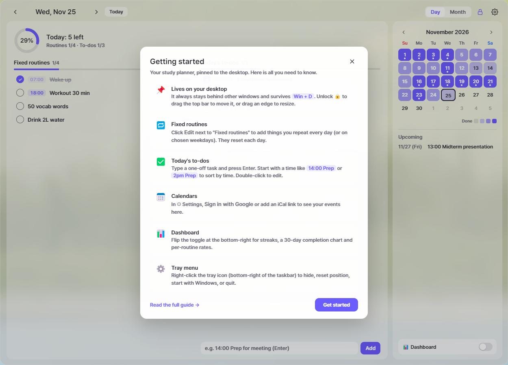
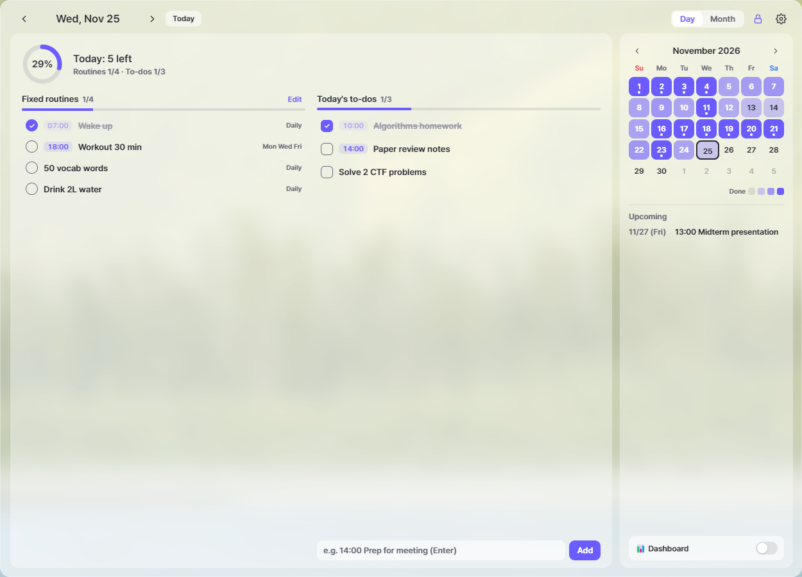
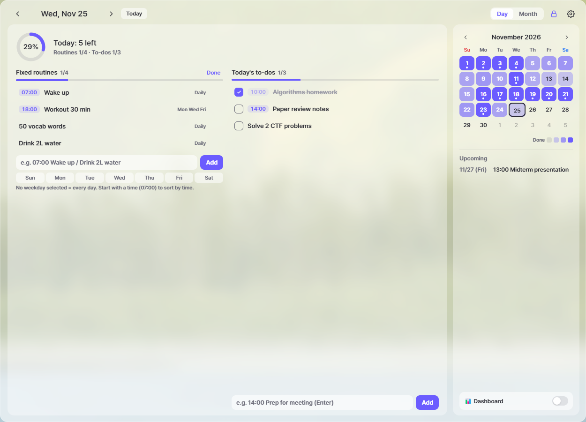
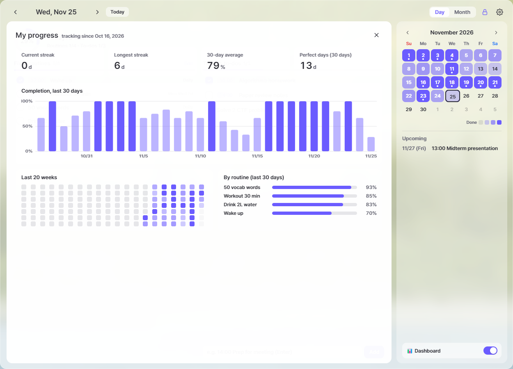

# Desktop Planner User Guide

<a href="GUIDE.md">한국어</a> · <b>English</b>

Everything about **Desktop Planner**, the study planner that lives on your Windows desktop.
The quick-start card you see on first launch is always available from ⚙ Settings → **📖 How to use**.

> All screenshots use sample data.

## Contents
1. [Install](#1-install)
2. [A quick tour](#2-a-quick-tour)
3. [Fixed routines](#3-fixed-routines)
4. [Today's to-dos](#4-todays-to-dos)
5. [Month view and history](#5-month-view-and-history)
6. [Dashboard](#6-dashboard)
7. [Calendars (Google · iCal)](#7-calendars)
8. [Position and appearance](#8-position-and-appearance)
9. [Tray menu and start with Windows](#9-tray-menu-and-start-with-windows)
10. [FAQ](#10-faq)

---

## 1. Install

1. Download `DesktopPlanner-Setup-x.y.z.exe` from the [latest release](https://github.com/bylhn/desktop-planner/releases/latest) and run it.
2. If **"Windows protected your PC"** appears, click **More info → Run anyway**. This personal project has no code-signing certificate.
3. When setup finishes, the planner appears on your desktop with a one-time **quick-start card**.

**Updates are automatic (from v1.3.4).** When a new version is out, the planner downloads it in the background and shows "Version x is ready" at the bottom. Click **Restart now**, or leave it — it's applied the next time the planner closes or the PC restarts. You can also use **Check for updates** at the bottom of Settings or in the tray menu. Your data is kept.

**Prefer to update yourself? (from v1.5.0)** ⚙ Settings → **Automatic updates → Off (notify only)**. When a new version is out you'll only see "Version x is available" at the bottom of Settings; it downloads and installs only when you click **Download** and then **Restart now** — never silently when the planner closes.

> Edits made directly to the installed app's files are replaced by updates. Your records and backups are stored separately and stay safe.

## 2. A quick tour

| Where | What |
|---|---|
| Top left | ◀ ▶ to move between days, **Today** to jump back |
| Top right | **Day / Month** view, 🔒 position lock, ⚙ Settings |
| Ring at the top | The day's completion rate and how many are left |
| Middle left | **Fixed routines** (repeat daily) |
| Middle right | **Today's to-dos** plus events from connected calendars |
| Right | Mini calendar shaded by completion, **Upcoming**, 📊 Dashboard toggle |

## 3. Fixed routines

A checklist that comes back every day, or only on weekdays you choose — great for habits like "Drink 2L water" or "07:00 Wake up".

- **Add:** click **Edit** next to "Fixed routines", type it and click **Add**.
- **Weekdays:** pick weekday buttons before adding to show it only on those days. None selected = every day.
- **Time:** start with a time (`07:00 Wake up`) to sort by time.
- **Check:** click the circle. Each new day starts unchecked.
- **Edit / delete:** double-click the text to edit; click ✕ in edit mode to delete. **Past history is kept** when you delete one.

## 4. Today's to-dos

One-off tasks for a given day. Type in the box at the bottom and press **Enter**.

- **Times:** `14:00 Prep for meeting`, `2pm Gym`, `2:30pm Submit` all work.
- **Check:** click the square to mark it done.
- **Edit / delete:** double-click to edit; hover and click ✕ to delete.
- **Plan ahead:** move to another day with ◀ ▶ or the mini calendar, then add.
- **Carry over:** ⚙ Settings → **Move unfinished past to-dos to today**.

## 5. Month view and history

- Click **Month** at the top for a full month: each day shows its completion % and calendar events. Click a date to see its to-dos below.
- Date cells show calendar events only. Click a date **once** to open a **scrollable panel** below with that day's events, where you can **add an event** (see section 7). Click the same date **again**, or any empty spot (e.g. next to **Today** at the top), **to close** it and see the whole month.
- Click the small **To-dos ▾** button next to the date to show (and check off) that day's to-dos.
- **Drag** across several dates to add an event to the whole range: without a time it becomes one all-day event spanning the days; with a time (`09:00 Gym`) the same event is added on each day.
- **Double-click** a date or click **Open day →** to open that day. You can still check or edit past days.
- In the day view, the mini calendar is **shaded by completion**, with a white dot on perfect days.

## 6. Dashboard

Flip **📊 Dashboard** at the bottom-right; flip it again (or press Esc) to close.

- **Current / longest streak:** consecutive days where you finished **everything** planned.
- **30-day average / perfect days:** counted over days that had something planned.
- **30-day chart:** darker bars are 100% days. Hover for details.
- **Last 20 weeks:** a heatmap of daily completion.
- **By routine:** see which routines you keep up with.

## 7. Calendars

Events you add to Google Calendar on your phone show up in the planner, and events you add in the planner's Month view go straight to Google Calendar (and your phone). Calendar events don't count toward completion. While you're using the PC they refresh every 15 minutes; refresh pauses while you're away (screen locked, idle) or the planner is hidden, and catches up as soon as you're back. Holiday calendars refresh once a day. Use **↻ Sync** in Settings to refresh right away.

### Google Calendar
1. ⚙ Settings → **Sign in with Google**.
2. Choose your account in the browser that opens.
3. If you see **"Google hasn't verified this app"**, click **Advanced → Go to Desktop Planner**. The app hasn't been through Google's review yet.
4. **Allow** access; when "Google Calendar is connected" appears, you're done.
5. Your calendars appear in Settings — tick the ones to show (holiday calendars included).
- **↻ Sync** refreshes now; **Disconnect** signs out and revokes access.

### Adding events from the planner
1. Click **Month** at the top, then click the **date** once.
2. Type the event in the box below and click **Add** (or press Enter).
   - `14:00 Meeting` → 14:00, one hour
   - `14:00-15:30 Study` → 14:00 to 15:30
   - `Mom's birthday` → all day
3. It goes straight into Google Calendar, so it shows on your phone too. With several calendars, pick which one next to the box.
4. To delete, hover over the event and click **✕** and it's deleted right away. It's removed from Google Calendar (and your phone) too.

> If you signed in before v1.4.0, the Month view shows **"Sign in again (allow adding events)"**. Click it once and allow access.

### 🔔 Reminders
- Hover an **event or to-do that has a time** and a **🔔** appears next to ✕. Click it (it turns blue) and a **silent** notification pops up at the bottom-right **5 minutes** before it starts.
- To ring something as you add it, turn on the 🔔 next to the input box first.
- Only items you ring are reminded. All-day events and to-dos without a time have no 🔔.
- Pick how early in ⚙ Settings → **Reminders**: 5 / 10 / 30 min, or Off.
- Clicking the notification brings the planner forward on that day. Reminders only show while the planner is running.

### iCloud, Outlook and others (iCal)
- **Outlook:** Settings → Calendar → Shared calendars → Publish a calendar → copy the **ICS** link
- **Apple iCloud:** in Calendar, share the calendar → turn on **Public Calendar** → copy the link (`webcal://` works)
- ⚙ Settings → "Other calendars (iCal link)" → enter a name and the link → **Add**.

## 8. Position and appearance

- **Move / resize:** click 🔒 to unlock (the border turns purple), drag the top bar to move and an edge to resize, then lock again.
- **Background opacity:** how see-through the planner is.
- **Text color:** "Dark text" for light wallpapers, "Light text" for dark ones.
- **Background blur:** the frosted-glass wallpaper effect, on or off.
- **Language:** 한국어 / English.

## 9. Tray menu and start with Windows

### Finding the icon

 This **purple checklist icon** at the **far right of the taskbar, left of the clock**, is the planner.
 

> 💡 **Can't see it?** Click the **^ (Show hidden icons)** arrow next to the clock — it may be tucked in there. Drag it onto the taskbar to keep it visible.

- **Click:** shows the planner again if you hid it.
- **Right-click:** opens the menu below.

### Right-click menu

| Item | What it does |
|---|---|
| **Hide / Show planner** | Temporarily hides the planner from the desktop, or brings it back. Hiding doesn't quit it. |
| **Unlock (move / resize)** / **Lock position** | Unlock to move and resize the planner; lock it again when done. (Same as the 🔒 button at the top.) |
| **Reset position** | Brings the planner back to the middle of the screen if it went off-screen. |
| **Start with Windows** | When ticked, the planner opens automatically when you sign in to Windows. |
| **Close** | Closes the planner on your desktop. The tray icon stays, so one click on it opens the planner again. |
| **More → Open data & backup folder** | Opens the folder with your data file and the daily automatic backups. |

## 10. FAQ

**I can't see the planner.**
Click the tray icon, or right-click → "Show planner". If it's off-screen, use "Reset position".

**I can't find the tray icon.**
Click the **^** arrow next to the clock to show hidden icons. The purple checklist icon is the planner.

**It won't come in front of other windows.**
By design — it's a desktop widget that always stays behind other windows. Hold the **⊞ Windows key and press D** (Show desktop) to minimize everything and see it; press it again to bring your windows back.

**Is my data kept after a restart?**
Yes. Everything is in `%APPDATA%\desktop-planner\planner-data.json`; closing the planner or shutting down never erases it.

**My records seem to be gone.**
The planner keeps a dated backup every day in `%APPDATA%\desktop-planner\backups` (last 30 days). If the data file is deleted or damaged, the newest backup is restored automatically the next time it starts. To roll back by hand: tray icon → **More → Open data & backup folder**, end **Desktop Planner** in Task Manager (Ctrl+Shift+Esc), copy the `backups\planner-data-DATE.json` you want over `planner-data.json`, then start the planner again.

**Google says "unverified app". Is it safe?**
It appears because this personal project hasn't been reviewed by Google yet. The app shows your calendar and only changes events you add or delete in the Month view. Events and tokens stay on your computer. → [Privacy policy](PRIVACY.md)

**How do I disconnect Google?**
⚙ Settings → Google Calendar → **Disconnect**, or remove Desktop Planner at [Google Account permissions](https://myaccount.google.com/permissions).

**How do I stop it starting with Windows?**
Right-click the tray icon → untick "Start with Windows", or turn it off in Windows Settings → Apps → Startup.

**Found a bug or have an idea?**
Open an issue on [GitHub Issues](https://github.com/bylhn/desktop-planner/issues).

---

Desktop Planner · made by <a href="https://github.com/bylhn">bylhn</a> · <a href="LICENSE">MIT License</a>
