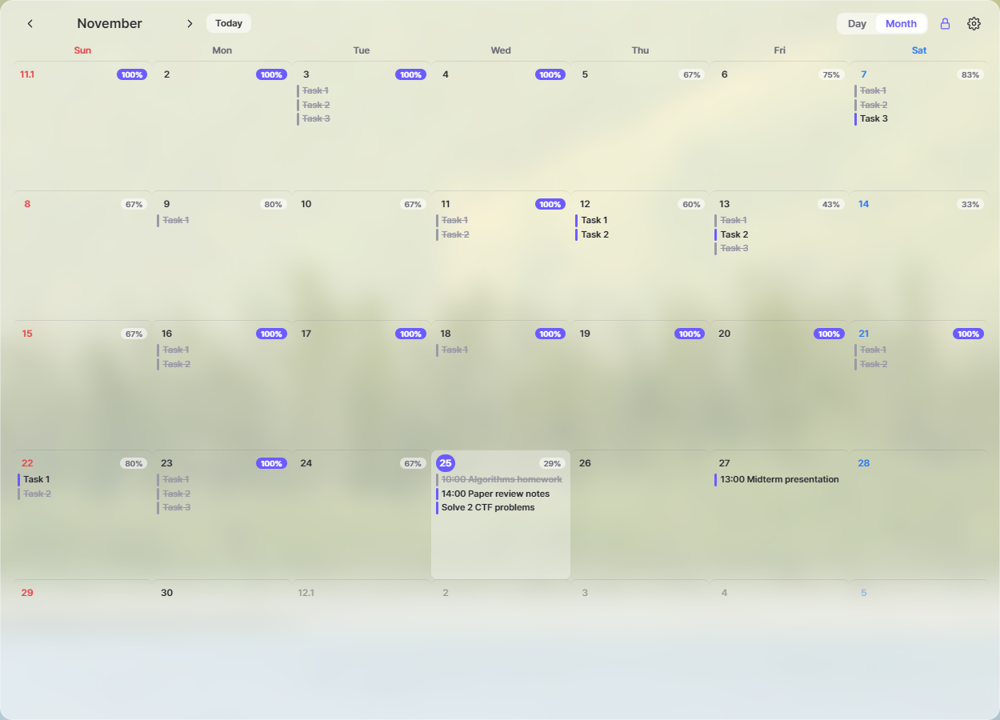
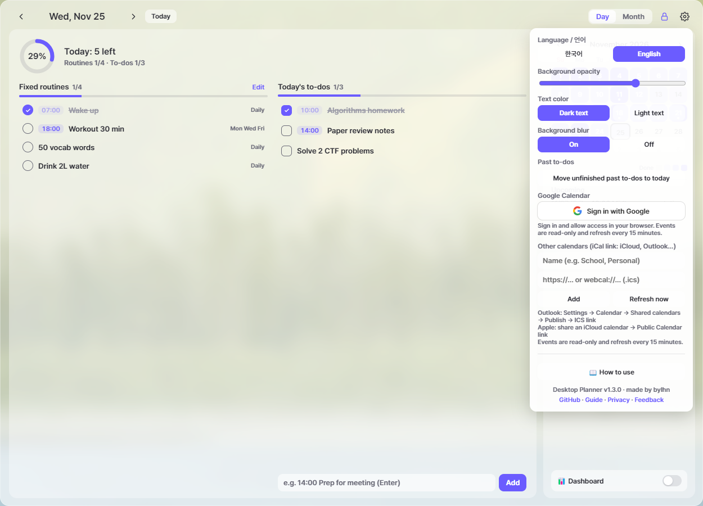
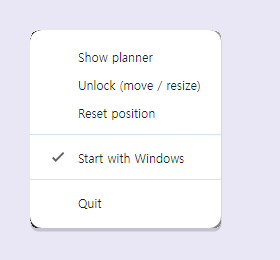

# Desktop Planner User Guide

<a href="GUIDE.md">한국어</a> · <b>English</b>

Everything about **Desktop Planner**, the study planner that lives on your Windows desktop.
The quick-start card you see on first launch is always available from ⚙ Settings → **📖 How to use**.

> All screenshots use sample data.

## Contents
1. [Install](#1-install)
2. [A quick tour](#2-a-quick-tour)
3. [Fixed routines](#3-fixed-routines)
4. [Today's to-dos](#4-todays-to-dos)
5. [Month view and history](#5-month-view-and-history)
6. [Dashboard](#6-dashboard)
7. [Calendars (Google · iCal)](#7-calendars)
8. [Position and appearance](#8-position-and-appearance)
9. [Tray menu and start with Windows](#9-tray-menu-and-start-with-windows)
10. [FAQ](#10-faq)

---

## 1. Install

1. Download `DesktopPlanner-Setup-x.y.z.exe` from the [latest release](https://github.com/bylhn/desktop-planner/releases/latest) and run it.
2. If **"Windows protected your PC"** appears, click **More info → Run anyway**. This personal project has no code-signing certificate.
3. When setup finishes, the planner appears on your desktop with a one-time **quick-start card**.

To update, just run the newer installer. Your data is kept.

## 2. A quick tour

| Where | What |
|---|---|
| Top left | ◀ ▶ to move between days, **Today** to jump back |
| Top right | **Day / Month** view, 🔒 position lock, ⚙ Settings |
| Ring at the top | The day's completion rate and how many are left |
| Middle left | **Fixed routines** (repeat daily) |
| Middle right | **Today's to-dos** plus events from connected calendars |
| Right | Mini calendar shaded by completion, **Upcoming**, 📊 Dashboard toggle |

## 3. Fixed routines

A checklist that comes back every day, or only on weekdays you choose — great for habits like "Drink 2L water" or "07:00 Wake up".

- **Add:** click **Edit** next to "Fixed routines", type it and click **Add**.
- **Weekdays:** pick weekday buttons before adding to show it only on those days. None selected = every day.
- **Time:** start with a time (`07:00 Wake up`) to sort by time.
- **Check:** click the circle. Each new day starts unchecked.
- **Edit / delete:** double-click the text to edit; click ✕ in edit mode to delete. **Past history is kept** when you delete one.

## 4. Today's to-dos

One-off tasks for a given day. Type in the box at the bottom and press **Enter**.

- **Times:** `14:00 Prep for meeting`, `2pm Gym`, `2:30pm Submit` all work.
- **Check:** click the square to mark it done.
- **Edit / delete:** double-click to edit; hover and click ✕ to delete.
- **Plan ahead:** move to another day with ◀ ▶ or the mini calendar, then add.
- **Carry over:** ⚙ Settings → **Move unfinished past to-dos to today**.

## 5. Month view and history

- Click **Month** at the top for a full month: each day shows its completion %, to-dos and calendar events.
- Click a date to open that day. You can still check or edit past days.
- In the day view, the mini calendar is **shaded by completion**, with a white dot on perfect days.

## 6. Dashboard

Flip **📊 Dashboard** at the bottom-right; flip it again (or press Esc) to close.

- **Current / longest streak:** consecutive days where you finished **everything** planned.
- **30-day average / perfect days:** counted over days that had something planned.
- **30-day chart:** darker bars are 100% days. Hover for details.
- **Last 20 weeks:** a heatmap of daily completion.
- **By routine:** see which routines you keep up with.

## 7. Calendars

Connected events are **read-only** — they're never changed by the planner and don't count toward completion. They refresh every 15 minutes.

### Google Calendar
1. ⚙ Settings → **Sign in with Google**.
2. Choose your account in the browser that opens.
3. If you see **"Google hasn't verified this app"**, click **Advanced → Go to Desktop Planner**. The app hasn't been through Google's review yet.
4. **Allow** access; when "Google Calendar is connected" appears, you're done.
5. Your calendars appear in Settings — tick the ones to show (holiday calendars included).
- **↻ Sync** refreshes now; **Disconnect** signs out and revokes access.

### iCloud, Outlook and others (iCal)
- **Outlook:** Settings → Calendar → Shared calendars → Publish a calendar → copy the **ICS** link
- **Apple iCloud:** in Calendar, share the calendar → turn on **Public Calendar** → copy the link (`webcal://` works)
- ⚙ Settings → "Other calendars (iCal link)" → enter a name and the link → **Add**.

## 8. Position and appearance

- **Move / resize:** click 🔒 to unlock (the border turns purple), drag the top bar to move and an edge to resize, then lock again.
- **Background opacity:** how see-through the planner is.
- **Text color:** "Dark text" for light wallpapers, "Light text" for dark ones.
- **Background blur:** the frosted-glass wallpaper effect, on or off.
- **Language:** 한국어 / English.

## 9. Tray menu and start with Windows

### Finding the icon

 This **purple checklist icon** at the **far right of the taskbar, left of the clock**, is the planner.
 

> 💡 **Can't see it?** Click the **^ (Show hidden icons)** arrow next to the clock — it may be tucked in there. Drag it onto the taskbar to keep it visible.

- **Click:** shows the planner again if you hid it.
- **Right-click:** opens the menu below.

### Right-click menu

| Item | What it does |
|---|---|
| **Hide / Show planner** | Temporarily hides the planner from the desktop, or brings it back. Hiding doesn't quit it. |
| **Unlock (move / resize)** / **Lock position** | Unlock to move and resize the planner; lock it again when done. (Same as the 🔒 button at the top.) |
| **Reset position** | Brings the planner back to the middle of the screen if it went off-screen. |
| **Start with Windows** | When ticked, the planner opens automatically when you sign in to Windows. |
| **Quit** | Fully closes the planner. Start it again from **Desktop Planner** on your desktop or Start menu. |

## 10. FAQ

**I can't see the planner.**
Click the tray icon, or right-click → "Show planner". If it's off-screen, use "Reset position".

**I can't find the tray icon.**
Click the **^** arrow next to the clock to show hidden icons. The purple checklist icon is the planner.

**It won't come in front of other windows.**
By design — it's a desktop widget that always stays behind other windows. Press `Win + D` to see it.

**Is my data kept after a restart?**
Yes. Everything is in `%APPDATA%\desktop-planner\planner-data.json`. Copy that file to back it up.

**Google says "unverified app". Is it safe?**
It appears because this personal project hasn't been reviewed by Google yet. The app only **reads** your calendar, and events and tokens stay on your computer. → [Privacy policy](PRIVACY.md)

**How do I disconnect Google?**
⚙ Settings → Google Calendar → **Disconnect**, or remove Desktop Planner at [Google Account permissions](https://myaccount.google.com/permissions).

**How do I stop it starting with Windows?**
Right-click the tray icon → untick "Start with Windows", or turn it off in Windows Settings → Apps → Startup.

**Found a bug or have an idea?**
Open an issue on [GitHub Issues](https://github.com/bylhn/desktop-planner/issues).

---

Desktop Planner · made by <a href="https://github.com/bylhn">bylhn</a> · <a href="LICENSE">MIT License</a>
