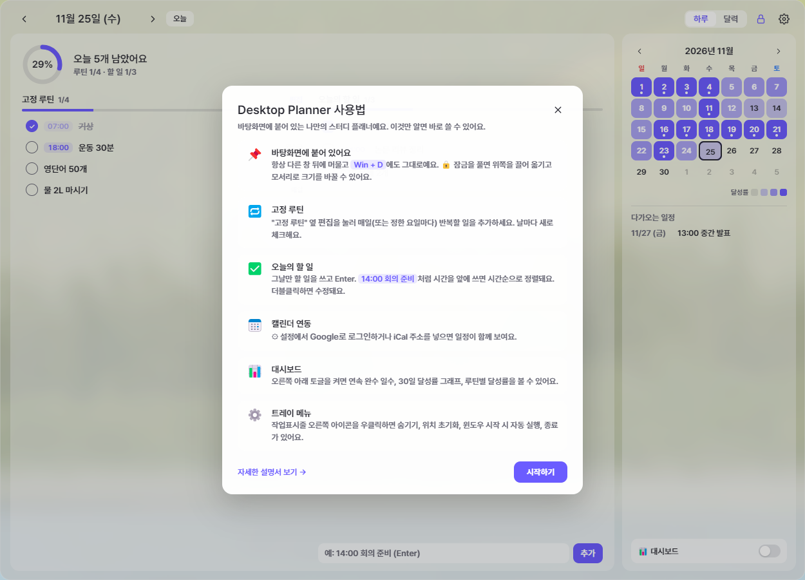
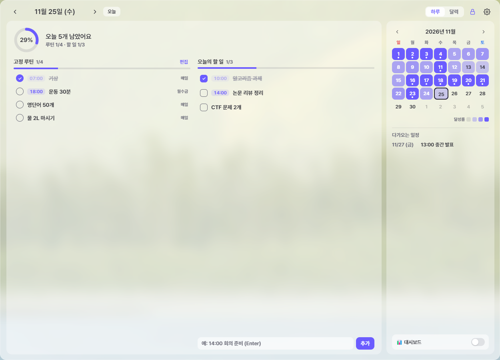
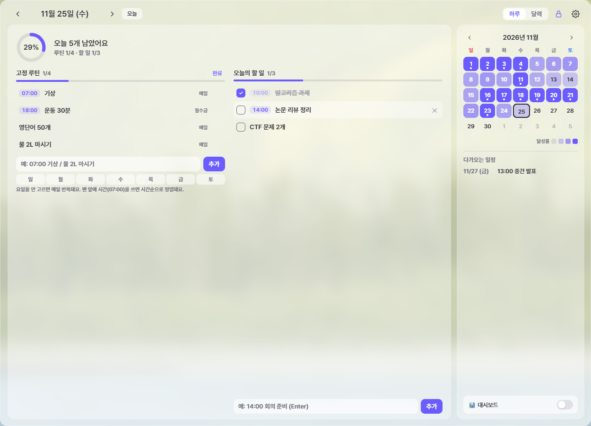
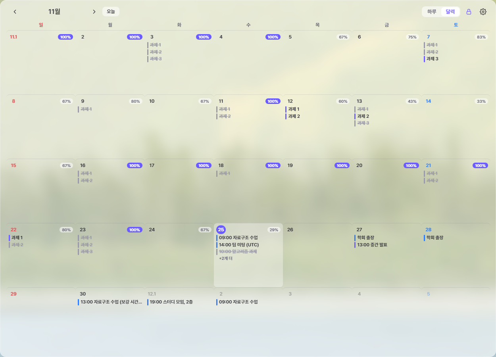
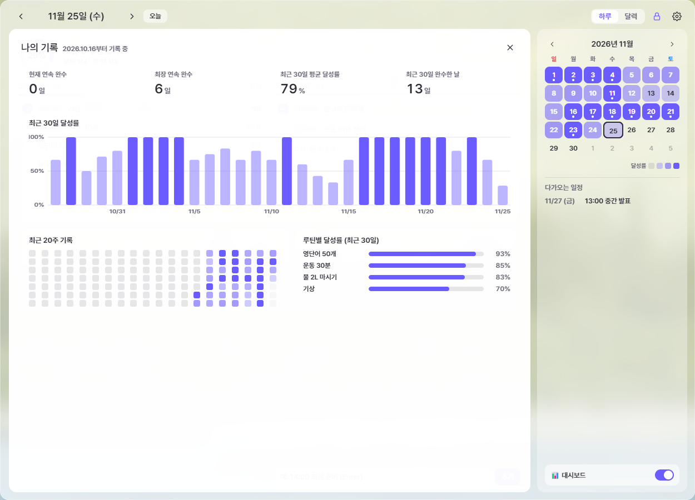
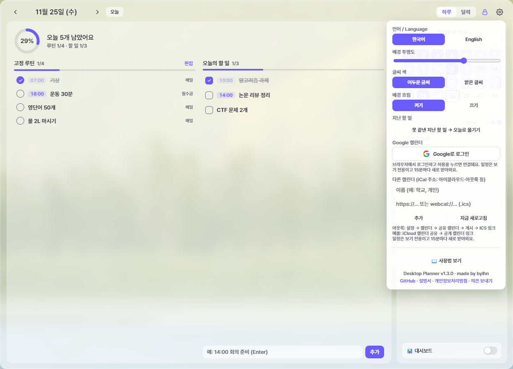
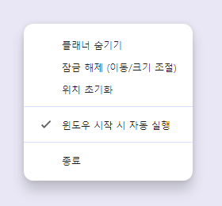

# Desktop Planner 사용 설명서

<b>한국어</b> · <a href="GUIDE.en.md">English</a>

바탕화면에 붙어 있는 스터디 플래너 **Desktop Planner**의 자세한 사용법이에요.
처음 켜면 나오는 "사용법" 카드는 ⚙ 설정 맨 아래 **📖 사용법 보기**로 언제든 다시 볼 수 있어요.

> 스크린샷은 모두 예시 데이터예요.

## 목차
1. [설치하기](#1-설치하기)
2. [화면 둘러보기](#2-화면-둘러보기)
3. [고정 루틴](#3-고정-루틴)
4. [오늘의 할 일](#4-오늘의-할-일)
5. [달력과 지난 기록](#5-달력과-지난-기록)
6. [대시보드](#6-대시보드)
7. [캘린더 연동 (Google · iCal)](#7-캘린더-연동)
8. [위치·모양 설정](#8-위치모양-설정)
9. [트레이 메뉴와 자동 실행](#9-트레이-메뉴와-자동-실행)
10. [자주 묻는 질문](#10-자주-묻는-질문)

---

## 1. 설치하기

1. [최신 릴리스](https://github.com/bylhn/desktop-planner/releases/latest)에서 `DesktopPlanner-Setup-x.y.z.exe`를 받아 실행해요.
2. **"Windows의 PC 보호"** 창이 뜨면 **추가 정보 → 실행**을 누르세요. 코드 서명 인증서가 없는 개인 프로젝트라서 나오는 안내예요.
3. 설치가 끝나면 바탕화면에 플래너가 나타나고, 처음 한 번 **사용법 카드**가 떠요.

**업데이트는 자동이에요 (v1.3.4부터).** 새 버전이 나오면 플래너가 알아서 받아 두고, 화면 아래에 "새 버전이 준비됐어요"가 떠요. **지금 다시 시작**을 누르거나, 그냥 두면 다음에 플래너를 끄거나 컴퓨터를 다시 켤 때 적용돼요. ⚙ 설정 맨 아래나 트레이 메뉴의 **업데이트 확인**으로 직접 확인할 수도 있어요. 기록은 그대로 유지돼요.

## 2. 화면 둘러보기

| 위치 | 내용 |
|---|---|
| 맨 위 왼쪽 | ◀ ▶로 다른 날짜로 이동, **오늘**로 돌아오기 |
| 맨 위 오른쪽 | **하루 / 달력** 보기 전환, 🔒 위치 잠금, ⚙ 설정 |
| 왼쪽 위 원 그래프 | 그날 달성률과 남은 개수 |
| 가운데 왼쪽 | **고정 루틴** (매일 반복) |
| 가운데 오른쪽 | **오늘의 할 일** + 연동한 캘린더 일정 (파란 줄) |
| 오른쪽 | 미니 달력 (달성률만큼 진하게), **다가오는 일정**, 📊 대시보드 토글 |

## 3. 고정 루틴

매일, 또는 정한 요일마다 자동으로 다시 생기는 체크리스트예요. "물 2L 마시기", "07:00 기상" 같은 습관에 써요.

- **추가:** "고정 루틴" 옆 **편집** → 입력칸에 쓰고 **추가**를 눌러요.
- **요일 지정:** 추가하기 전에 요일 버튼을 고르면 그 요일에만 나와요. 아무것도 안 고르면 매일이에요.
- **시간:** `07:00 기상`처럼 앞에 시간을 쓰면 시간순으로 정렬돼요.
- **체크:** 동그라미를 누르면 완료. 다음 날이 되면 다시 비어 있는 상태로 시작해요.
- **수정 / 삭제:** 글자를 더블클릭하면 수정, 편집 모드에서 ✕를 누르면 삭제예요. 삭제해도 **지난 기록은 그대로 남아요.**

## 4. 오늘의 할 일

그날만 하는 일이에요. 아래 입력칸에 쓰고 **Enter**를 누르면 추가돼요.

- **시간 붙이기:** `14:00 회의 준비`, `2시 30분 과제 제출`, `2pm 운동` 모두 알아들어요.
- **체크:** 네모를 누르면 완료 표시(취소선)가 돼요.
- **수정 / 삭제:** 더블클릭으로 수정, 마우스를 올리면 나오는 ✕로 삭제.
- **다른 날에 미리 추가:** ◀ ▶나 미니 달력으로 그 날짜로 간 다음 입력하면 돼요.
- **못 끝낸 일 옮기기:** ⚙ 설정 → **못 끝낸 지난 할 일 → 오늘로 옮기기**를 누르면 지난 날짜의 미완료 할 일이 오늘로 와요.

## 5. 달력과 지난 기록

- 맨 위 **달력**을 누르면 월간 달력이 나와요. 날짜마다 달성률(%)과 할 일, 캘린더 일정이 보여요.
- 날짜를 **한 번** 누르면 아래에 그날의 캘린더 일정이 나오고, **일정을 바로 등록**할 수 있어요(아래 7번 참고).
- 날짜를 **두 번** 누르거나 **하루 보기 →**를 누르면 그날의 하루 화면으로 이동해요. 지난 날짜도 체크·수정할 수 있어요.
- 하루 화면 오른쪽 미니 달력은 **달성률만큼 진하게** 칠해지고, 다 끝낸 날에는 흰 점이 찍혀요.

## 6. 대시보드

오른쪽 아래 **📊 대시보드** 토글을 켜면 열리고, 다시 누르거나 Esc를 누르면 닫혀요.

- **현재 / 최장 연속 완수:** 그날 할 일과 루틴을 **모두** 끝낸 날이 며칠 연속인지.
- **최근 30일 평균 달성률 / 완수한 날:** 할 일이 있었던 날 기준이에요.
- **30일 막대 그래프:** 진한 막대가 100% 완수한 날. 마우스를 올리면 자세한 숫자가 나와요.
- **20주 기록:** 날짜별 달성률 히트맵.
- **루틴별 달성률:** 어떤 루틴을 잘 지키고 있는지 한눈에 볼 수 있어요.

## 7. 캘린더 연동

폰에서 구글 캘린더에 넣은 일정이 플래너에 뜨고, 플래너 달력 화면에서 등록한 일정도 구글 캘린더(폰)에 바로 들어가요. 캘린더 일정은 달성률 계산에는 들어가지 않아요. 컴퓨터를 쓰는 동안 15분마다 자동으로 새로 받아오고, 자리를 비웠거나(화면 잠금 등) 플래너를 숨긴 동안에는 쉬었다가 돌아오면 바로 새로 받아요. 공휴일 캘린더는 하루 한 번만 받아요. 바로 새로 받고 싶으면 설정의 **↻ 동기화**를 누르세요.

### Google 캘린더
1. ⚙ 설정 → **Google로 로그인**을 눌러요.
2. 브라우저가 열리면 계정을 고르세요.
3. **"Google에서 확인하지 않은 앱"**이 나오면 **고급 → Desktop Planner(으)로 이동**을 누르세요. 구글 심사 전인 개인 프로젝트라 나오는 화면이에요.
4. 권한을 **허용**하고 "Google 캘린더가 연결됐어요"가 나오면 끝이에요.
5. 설정에 내 캘린더 목록이 나오고, 체크로 표시할 캘린더를 고를 수 있어요. 공휴일 캘린더도 여기서 켜고 끌 수 있어요.
- **↻ 동기화**로 바로 새로 받기, **연결 해제**로 연결을 끊고 구글 쪽 권한도 취소할 수 있어요.

### 플래너에서 일정 등록하기
1. 맨 위 **달력**을 누르고, 일정을 넣을 **날짜를 한 번** 눌러요.
2. 아래 칸에 일정을 쓰고 **등록**(또는 Enter)을 눌러요.
   - `14:00 회의` → 14시부터 1시간
   - `14:00-15:30 스터디` → 14시~15시 30분
   - `엄마 생일` → 종일 일정
3. 구글 캘린더에 바로 들어가서 폰에서도 보여요. 캘린더가 여러 개면 옆에서 넣을 캘린더를 고를 수 있어요.
4. 지우려면 일정에 마우스를 올리고 **✕** → 확인. 구글 캘린더(폰)에서도 지워져요.

> v1.4.0 전에 로그인했다면 일정 등록 권한이 없어서, 달력 화면에 **"Google 다시 로그인 (일정 등록 허용)"** 버튼이 나와요. 한 번만 눌러서 허용하면 돼요.

### 아이클라우드 · 아웃룩 등 (iCal)
- **아웃룩:** 설정 → 캘린더 → 공유 캘린더 → 캘린더 게시 → **ICS 링크** 복사
- **애플 iCloud:** 캘린더 앱에서 캘린더 공유 → **공개 캘린더** 켜기 → 링크 복사 (`webcal://`도 돼요)
- ⚙ 설정 → "다른 캘린더 (iCal 주소)"에 이름과 주소를 넣고 **추가**.

## 8. 위치·모양 설정

- **옮기기 / 크기:** 🔒를 눌러 잠금을 풀면 테두리가 보라색으로 바뀌어요. 위쪽을 끌어 옮기고 가장자리를 끌어 크기를 바꾼 뒤, 다시 🔒로 잠그세요.
- **배경 투명도:** 슬라이더로 얼마나 비칠지 정해요.
- **글씨 색:** 밝은 배경화면이면 "어두운 글씨", 어두운 배경화면이면 "밝은 글씨".
- **배경 흐림:** 배경화면을 흐리게 비추는 유리 효과를 켜고 끌 수 있어요.
- **언어:** 한국어 / English.

## 9. 트레이 메뉴와 자동 실행

### 아이콘 찾기

 작업표시줄 **오른쪽 끝, 시계 왼쪽**에 있는 이 **보라색 체크리스트 아이콘**이 플래너예요.
 

> 💡 **아이콘이 안 보이면** 시계 왼쪽의 **^ (숨겨진 아이콘 표시)** 화살표를 눌러 보세요. 그 안에 들어가 있을 수 있어요. 아이콘을 작업표시줄로 끌어다 놓으면 항상 보여요.

- **클릭:** 숨겨 둔 플래너를 다시 보여 줘요.
- **우클릭:** 아래 메뉴가 열려요.

### 우클릭 메뉴

| 메뉴 | 하는 일 |
|---|---|
| **플래너 숨기기 / 보이기** | 바탕화면에서 플래너를 잠깐 숨기거나 다시 보여 줘요. 숨겨도 꺼지지 않아요. |
| **잠금 해제 (이동/크기 조절)** / **위치 잠그기** | 잠금을 풀면 플래너를 옮기고 크기를 바꿀 수 있어요. 다 했으면 다시 잠그세요. (화면 위쪽 🔒 버튼과 같아요) |
| **위치 초기화** | 플래너가 화면 밖으로 나가 안 보일 때, 화면 가운데로 되돌려요. |
| **윈도우 시작 시 자동 실행** | 체크하면 컴퓨터를 켤 때 플래너가 자동으로 떠요. |
| **종료** | 플래너를 완전히 꺼요. 다시 켜려면 바탕화면이나 시작 메뉴의 **Desktop Planner**를 실행하세요. |

## 10. 자주 묻는 질문

**플래너가 안 보여요.**
트레이 아이콘을 클릭하거나 우클릭 → "플래너 보이기"를 누르세요. 화면 밖으로 나갔다면 "위치 초기화"를 누르면 돼요.

**트레이 아이콘을 못 찾겠어요.**
작업표시줄 오른쪽 시계 옆의 **^** 화살표를 누르면 숨겨진 아이콘들이 나와요. 보라색 체크리스트 아이콘이 플래너예요.

**다른 창 위로 안 올라와요.**
바탕화면 위젯이라 일부러 항상 다른 창 뒤에 있어요. 키보드 왼쪽 아래 **⊞ 윈도우 키를 누른 채 D**(바탕화면 보기)를 누르면 창들이 내려가고 플래너가 보여요. 한 번 더 누르면 창들이 돌아와요.

**컴퓨터를 껐다 켜도 기록이 남나요?**
네. 모든 기록은 `%APPDATA%\desktop-planner\planner-data.json`에 저장돼요. 백업하려면 이 파일을 복사해 두세요.

**구글 로그인 때 "확인되지 않은 앱"이 떠요. 안전한가요?**
구글 심사를 아직 받지 않은 개인 프로젝트라서 나와요. 앱은 캘린더를 보여 주고, 내가 달력 화면에서 등록하거나 지우라고 한 일정만 바꿔요. 일정과 로그인 정보는 내 컴퓨터에만 저장돼요. → [개인정보처리방침](PRIVACY.md)

**구글 연결을 끊고 싶어요.**
⚙ 설정 → Google 캘린더 → **연결 해제**. 또는 [Google 계정 권한 페이지](https://myaccount.google.com/permissions)에서 Desktop Planner를 삭제하세요.

**자동 실행을 끄고 싶어요.**
트레이 아이콘 우클릭 → "윈도우 시작 시 자동 실행" 체크 해제. Windows 설정 → 앱 → 시작프로그램에서도 끌 수 있어요.

**버그를 찾았거나 기능을 제안하고 싶어요.**
[GitHub Issues](https://github.com/bylhn/desktop-planner/issues)에 남겨 주세요.

---

Desktop Planner · made by <a href="https://github.com/bylhn">bylhn</a> · <a href="LICENSE">MIT License</a>
