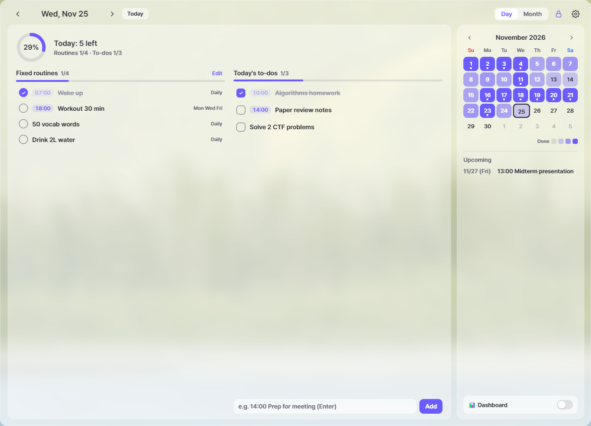
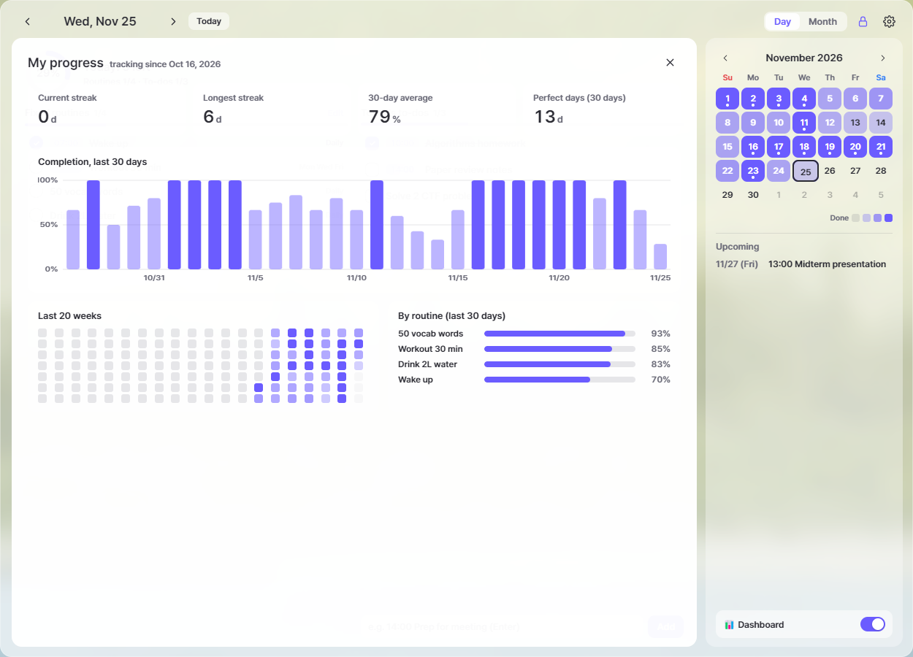

# Desktop Planner

<p align="center"><a href="README.md">한국어</a> · <b>English</b></p>

A **transparent study-planner widget that lives on your Windows desktop**.
Check off fixed daily routines and each day's to-dos, and look back on your progress with charts.

<p align="center">
  <a href="https://github.com/bylhn/desktop-planner/releases/latest">
    
  </a>
</p>
<p align="center"><sub>Windows 10/11 (64-bit) · Free · No account needed</sub></p>

> The app is available in **English and Korean**. It follows your Windows language, and you can switch any time in ⚙ Settings → Language.



## Features

- **Pinned to the desktop** — no taskbar button; it always stays behind other windows, right on your desktop. It survives `Win + D`.
- **Frosted-glass look** — shows a blurred copy of your wallpaper; adjustable transparency and light/dark text.
- **Fixed routines** — a checklist that comes back every day, or only on the weekdays you pick.
- **Today's to-dos** — one-off tasks for a given day. Start with a time, like `14:00 Prepare meeting`, and they are sorted by time.
- **Completion history** — every check is recorded per day, and the mini calendar is shaded by how much you got done.
- **Dashboard** — current and longest streak, 30-day completion chart, 20-week heatmap, and per-routine completion rates. Toggle it from the bottom-right corner.
- **Calendar subscriptions** — show events from any calendar that offers an iCal (ICS) link: Google, Outlook, Apple, and more (read-only, refreshed every 15 minutes).
- **Month view**, move unfinished past to-dos to today, start with Windows.



## Install

1. Click **Download for Windows** above (or open the [latest release](https://github.com/bylhn/desktop-planner/releases/latest)) and run `DesktopPlanner-Setup-x.y.z.exe`.
2. This is a personal project without a code-signing certificate, so Windows may show a "Windows protected your PC" warning. Click **More info → Run anyway**.
3. When setup finishes, the planner appears on your desktop. Right-click its tray icon (bottom-right of the taskbar) for start-with-Windows, reset position, and quit.

> Runs on Windows 10/11 (64-bit) on its own — no other app or account required.

## How to use

| To do this | Do this |
|---|---|
| Move / resize | Click 🔒 to unlock → drag the top bar to move, drag an edge to resize → lock again |
| Add a fixed routine | Click **Edit** next to **Fixed routines** → type it, pick weekdays (none = every day) |
| Add a to-do | Type in the box at the bottom and press Enter. A leading time sorts it: `07:00 Wake up` or `7am Wake up` |
| Edit / delete | Double-click the text to edit; hover and click ✕ to delete |
| See another day | ◀ ▶ at the top, or click a date in the mini calendar |
| Dashboard | Toggle **📊 Dashboard** at the bottom-right (Esc also closes it) |
| Subscribe to a calendar | ⚙ Settings → **Calendar sync** → paste an iCal link → **Add** |
| Change language | ⚙ Settings → **Language** → 한국어 / English |

### Finding your calendar's iCal link

- **Google Calendar**: on the web, Settings → pick your calendar on the left → "Integrate calendar" → copy **Secret address in iCal format**
- **Outlook**: Settings → Calendar → Shared calendars → Publish a calendar → copy the **ICS** link
- **Apple iCloud**: in Calendar, share the calendar → turn on **Public Calendar** → copy the link (`webcal://` links work too)

> Treat a secret address like a password: anyone who has it can see your events.

## Data & privacy

Everything is stored only on your computer, in `%APPDATA%\desktop-planner\planner-data.json`.
There is no sign-in and your records are never uploaded. The only network access is downloading events from the iCal links you add.
To back up, just copy that file.

## Run from source (developers)

Requires [Node.js](https://nodejs.org/) 18 or later.

```bash
npm install
npm start
```

Build the installer:

```bash
npm run dist
```

The installer is written to `dist/`. To redraw the icon, run `npm run icon` (needs Python + Pillow).

## License

[MIT](LICENSE)
