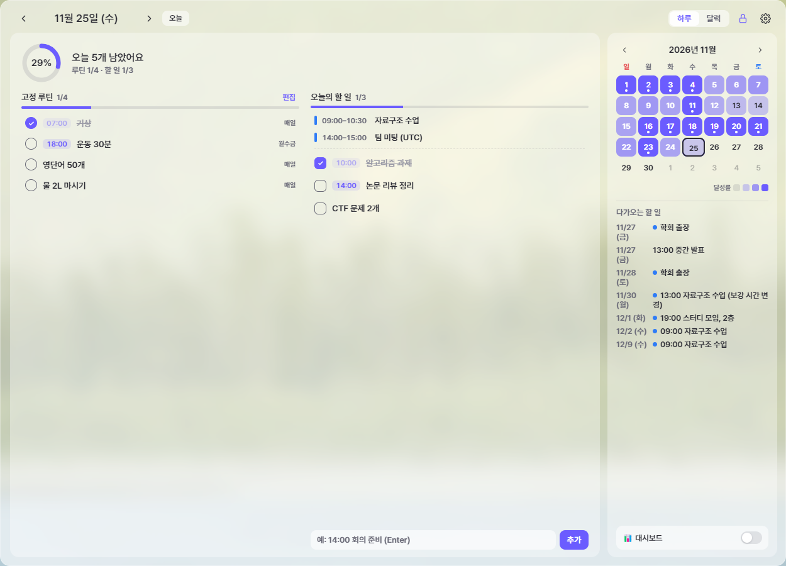

# Desktop Planner

<p align="center"><b>한국어</b> · <a href="README.en.md">English</a></p>

바탕화면에 붙어 있는 **투명 스터디 플래너 위젯**입니다.
매일 반복하는 고정 루틴과 그날그날의 할 일을 체크하고, 달성 기록을 그래프로 돌아볼 수 있어요.

<p align="center">
  <a href="https://github.com/bylhn/desktop-planner/releases/latest">
    
  </a>
</p>
<p align="center"><sub>Windows 10/11 (64비트) · 무료 · 로그인 불필요 · 📖 <a href="GUIDE.md">사용 설명서</a> · 🌐 <a href="https://bylhn.github.io/desktop-planner/">홈페이지</a></sub></p>
<p align="center">▶ <a href="https://bylhn.github.io/desktop-planner/#try"><b>설치 없이 웹에서 바로 써 보기</b></a> · 📄 <a href="https://bylhn.github.io/desktop-planner/DesktopPlanner-guide.pdf">설치·사용 가이드 PDF</a></p>



## 주요 기능

- **바탕화면 고정** — 작업표시줄에 뜨지 않고 항상 다른 창 뒤, 바탕화면 위에 머물러요. **⊞ 윈도우 키 + D**(바탕화면 보기)를 누르면 다른 창이 내려가고 플래너만 보여요.
- **반투명 유리 효과** — 배경화면을 흐리게 비춰 주고, 투명도와 글씨 색을 조절할 수 있어요.
- **고정 루틴** — 매일 또는 정한 요일마다 자동으로 다시 생기는 체크리스트예요.
- **오늘의 할 일** — 그날만 하는 일을 추가해요. `14:00 회의 준비`처럼 앞에 시간을 쓰면 시간순으로 정렬돼요.
- **달성 기록** — 날짜별 체크 기록이 남고, 미니 달력이 달성률만큼 진하게 칠해져요.
- **대시보드** — 연속 완수 일수, 최근 30일 달성률 그래프, 20주 히트맵, 루틴별 달성률을 보여 줘요. 오른쪽 아래 토글로 열고 닫아요.
- **Google 캘린더 로그인 연동** — "Google로 로그인" 한 번이면 내 구글 캘린더(공휴일 포함) 일정이 플래너에 함께 보여요. 표시할 캘린더를 고를 수 있어요 (사용 중 15분마다 자동 갱신).
- **달력에서 일정 등록** — 달력 화면에서 날짜를 누르고 `14:00 회의`(1시간), `14:00-15:30 스터디`, `엄마 생일`(종일)처럼 쓰면 구글 캘린더에 바로 들어가서 폰에서도 보여요. 폰에서 넣은 일정도 플래너에 떠요.
- **드래그로 연속 일정 한 번에** — 날짜를 누른 채 다른 날짜까지 끌면 기간이 선택돼요. 시간 없이 쓰면 기간 전체에 걸친 종일 일정 하나, `09:00 운동`처럼 시간을 쓰면 날마다 같은 일정이 들어가요.
- **일정 삭제** — 일정의 ✕를 누르면 바로 지워지고 폰에서도 사라져요.
- **🔔 골라서 받는 알림** — 시간이 있는 일정이나 할 일에 마우스를 올려 🔔를 누르면, 시작 5분 전(10·30분으로 바꿀 수 있음)에 소리 없이 Windows 알림이 떠요. 누른 것만 알려 주고, 알림을 누르면 그날 화면이 열려요.
- **자동 백업** — 매일 기록을 날짜별로 백업(최근 30일)하고, 파일이 깨지면 다음 실행 때 자동 복구해요. 트레이 아이콘은 종료해도 항상 남아요.
- **iCal 연동** — 아이클라우드·아웃룩 등 iCal(ICS) 주소를 주는 캘린더도 연결할 수 있어요.
- **한국어 / English** — 윈도우 언어를 따라가고, ⚙ 설정에서 언제든 바꿀 수 있어요.
- **월간 달력 보기** — 날짜를 한 번 누르면 그날 일정이 아래에 펼쳐져서 스크롤해 볼 수 있고, 날짜 옆 **할 일 ▾** 버튼으로 그날 할 일도 볼 수 있어요. 같은 날짜를 다시 누르거나 빈 곳을 누르면 닫히고, 두 번 누르면 하루 화면으로 이동해요.
- 못 끝낸 할 일을 오늘로 옮기기, 윈도우 시작 시 자동 실행


## 설치 (일반 사용자)

1. **[여기를 누르면 설치 파일이 바로 받아져요](https://github.com/bylhn/desktop-planner/releases/latest/download/DesktopPlanner-Setup.exe)** (항상 최신 버전). 받은 `DesktopPlanner-Setup.exe`를 실행하세요.
2. 코드 서명이 없는 개인 프로젝트라 Windows가 "PC 보호" 경고를 띄울 수 있어요. **추가 정보 → 실행**을 누르면 설치됩니다.
3. 설치가 끝나면 바탕화면에 플래너가 나타나요. 작업표시줄 오른쪽(시계 옆)의 보라색 트레이 아이콘을 우클릭하면 자동 실행, 위치 초기화, 종료 메뉴가 있어요. 아이콘이 안 보이면 시계 옆 **^** 를 눌러 보세요.

> Windows 10/11 (64비트)에서 동작해요. 다른 앱이나 계정 없이 단독으로 쓸 수 있어요.

## 사용법

| 하고 싶은 것 | 방법 |
|---|---|
| 위치·크기 바꾸기 | 🔒 버튼으로 잠금 해제 → 위쪽을 끌어 이동, 모서리로 크기 조절 → 다시 잠금 |
| 고정 루틴 추가 | "고정 루틴" 옆 **편집** → 입력 후 요일 선택(선택 안 하면 매일) |
| 할 일 추가 | 아래 입력칸에 쓰고 Enter (`07:00 기상`처럼 시간 붙이기 가능) |
| 수정 / 삭제 | 글자를 더블클릭해서 수정, 마우스를 올리면 나오는 ✕로 삭제 |
| 다른 날 보기 | 위쪽 ◀ ▶ 또는 오른쪽 미니 달력 클릭 |
| 대시보드 | 오른쪽 아래 **📊 대시보드** 토글 (Esc로도 닫힘) |
| Google 캘린더 | ⚙ 설정 → **Google로 로그인** → 브라우저에서 계정 선택 후 허용 |
| 다른 캘린더 | ⚙ 설정 → "다른 캘린더 (iCal 주소)"에 주소 붙여 넣고 추가 |

### Google 로그인할 때

구글 심사를 아직 받지 않은 개인 프로젝트라 **"Google에서 확인하지 않은 앱"** 화면이 나와요. **고급 → Desktop Planner(으)로 이동**을 누른 뒤 허용하면 돼요. 앱은 내가 달력 화면에서 등록하거나 지운 일정만 바꾸고, 일정은 내 컴퓨터에만 저장돼요. 자세한 내용은 [개인정보처리방침](PRIVACY.md)을 봐 주세요.

### iCal 주소 찾는 법

- **아웃룩**: 설정 → 캘린더 → 공유 캘린더 → 캘린더 게시 → **ICS 링크** 복사
- **애플 iCloud**: 캘린더 앱에서 캘린더 공유 → **공개 캘린더** 켜기 → 링크 복사 (`webcal://`로 시작해도 돼요)

> 비공개 주소는 비밀번호처럼 다뤄 주세요. 이 주소를 아는 사람은 일정을 볼 수 있어요.

## 데이터와 개인정보

모든 기록은 내 컴퓨터의 `%APPDATA%\desktop-planner\planner-data.json`에만 저장돼요.
계정 가입이 필요 없고, 기록을 외부로 보내지 않아요. 인터넷은 연동한 캘린더(Google, iCal)에서 일정을 받아올 때만 써요. Google 로그인 정보는 Windows 암호화로 내 컴퓨터에만 저장돼요. → [개인정보처리방침](PRIVACY.md)
백업하려면 이 파일을 복사해 두면 됩니다.

## 소스에서 실행하기 (개발자)

[Node.js](https://nodejs.org/) 18 이상이 필요해요.

```bash
npm install
npm start
```

설치 파일 만들기:

```bash
npm run dist
```

`dist/` 폴더에 설치 파일이 생겨요. 아이콘을 다시 그리려면 `npm run icon` (Python + Pillow 필요).

Google 로그인을 쓰려면 Google Cloud에서 **데스크톱 앱** 유형의 OAuth 클라이언트를 만들고(Calendar API 사용 설정), 받은 JSON을 `google-client.json`으로 저장하세요. 이 파일은 git에 올라가지 않아요.

## 라이선스

[MIT](LICENSE)
