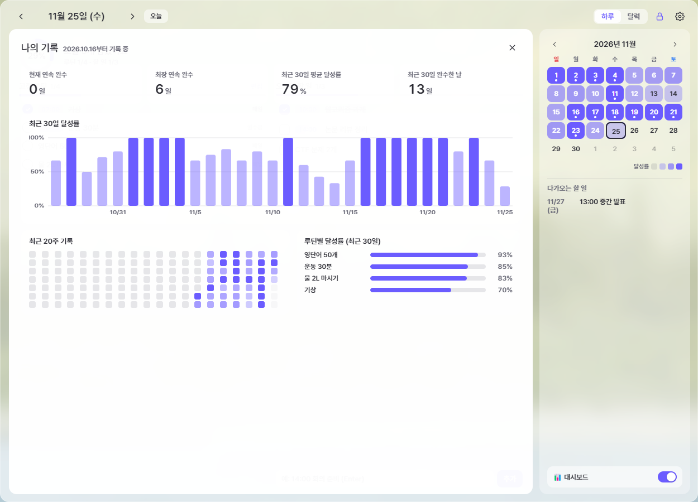

# Desktop Planner

<p align="center"><b>한국어</b> · <a href="README.en.md">English</a></p>

바탕화면에 붙어 있는 **투명 스터디 플래너 위젯**입니다.
매일 반복하는 고정 루틴과 그날그날의 할 일을 체크하고, 달성 기록을 그래프로 돌아볼 수 있어요.

<p align="center">
  <a href="https://github.com/bylhn/desktop-planner/releases/latest">
    
  </a>
</p>
<p align="center"><sub>Windows 10/11 (64비트) · 무료 · 로그인 불필요</sub></p>


## 주요 기능

- **바탕화면 고정** — 작업표시줄에 뜨지 않고 항상 다른 창 뒤, 바탕화면 위에 머물러요. `Win + D`를 눌러도 사라지지 않아요.
- **반투명 유리 효과** — 배경화면을 흐리게 비춰 주고, 투명도와 글씨 색을 조절할 수 있어요.
- **고정 루틴** — 매일 또는 정한 요일마다 자동으로 다시 생기는 체크리스트예요.
- **오늘의 할 일** — 그날만 하는 일을 추가해요. `14:00 회의 준비`처럼 앞에 시간을 쓰면 시간순으로 정렬돼요.
- **달성 기록** — 날짜별 체크 기록이 남고, 미니 달력이 달성률만큼 진하게 칠해져요.
- **대시보드** — 연속 완수 일수, 최근 30일 달성률 그래프, 20주 히트맵, 루틴별 달성률을 보여 줘요. 오른쪽 아래 토글로 열고 닫아요.
- **캘린더 연동** — 구글·아웃룩·애플 등 iCal(ICS) 주소를 주는 캘린더라면 어디든 일정을 불러와 함께 보여 줘요 (보기 전용, 15분마다 갱신).
- **월간 달력 보기**, 못 끝낸 할 일을 오늘로 옮기기, 윈도우 시작 시 자동 실행



## 설치 (일반 사용자)

1. 위의 **Windows 다운로드** 버튼(또는 [최신 릴리스 페이지](https://github.com/bylhn/desktop-planner/releases/latest))에서 `DesktopPlanner-Setup-x.y.z.exe`를 내려받아 실행하세요.
2. 코드 서명이 없는 개인 프로젝트라 Windows가 "PC 보호" 경고를 띄울 수 있어요. **추가 정보 → 실행**을 누르면 설치됩니다.
3. 설치가 끝나면 바탕화면에 플래너가 나타나요. 작업표시줄 오른쪽의 트레이 아이콘을 우클릭하면 자동 실행, 위치 초기화, 종료 메뉴가 있어요.

> Windows 10/11 (64비트)에서 동작해요. 다른 앱이나 계정 없이 단독으로 쓸 수 있어요.

## 사용법

| 하고 싶은 것 | 방법 |
|---|---|
| 위치·크기 바꾸기 | 🔒 버튼으로 잠금 해제 → 위쪽을 끌어 이동, 모서리로 크기 조절 → 다시 잠금 |
| 고정 루틴 추가 | "고정 루틴" 옆 **편집** → 입력 후 요일 선택(선택 안 하면 매일) |
| 할 일 추가 | 아래 입력칸에 쓰고 Enter (`07:00 기상`처럼 시간 붙이기 가능) |
| 수정 / 삭제 | 글자를 더블클릭해서 수정, 마우스를 올리면 나오는 ✕로 삭제 |
| 다른 날 보기 | 위쪽 ◀ ▶ 또는 오른쪽 미니 달력 클릭 |
| 대시보드 | 오른쪽 아래 **📊 대시보드** 토글 (Esc로도 닫힘) |
| 캘린더 연동 | ⚙ 설정 → "캘린더 연동"에 iCal 주소 붙여 넣고 추가 |

### 캘린더 iCal 주소 찾는 법

- **구글 캘린더**: 웹에서 설정 → 왼쪽에서 내 캘린더 선택 → "캘린더 통합" → **iCal 형식의 비공개 주소** 복사
- **아웃룩**: 설정 → 캘린더 → 공유 캘린더 → 캘린더 게시 → **ICS 링크** 복사
- **애플 iCloud**: 캘린더 앱에서 캘린더 공유 → **공개 캘린더** 켜기 → 링크 복사 (`webcal://`로 시작해도 돼요)

> 비공개 주소는 비밀번호처럼 다뤄 주세요. 이 주소를 아는 사람은 일정을 볼 수 있어요.

## 데이터와 개인정보

모든 기록은 내 컴퓨터의 `%APPDATA%\desktop-planner\planner-data.json`에만 저장돼요.
로그인이 필요 없고, 기록을 외부로 보내지 않아요. 인터넷은 캘린더를 연동했을 때 그 iCal 주소에서 일정을 받아올 때만 써요.
백업하려면 이 파일을 복사해 두면 됩니다.

## 소스에서 실행하기 (개발자)

[Node.js](https://nodejs.org/) 18 이상이 필요해요.

```bash
npm install
npm start
```

설치 파일 만들기:

```bash
npm run dist
```

`dist/` 폴더에 설치 파일이 생겨요. 아이콘을 다시 그리려면 `npm run icon` (Python + Pillow 필요).

## 라이선스

[MIT](LICENSE)
